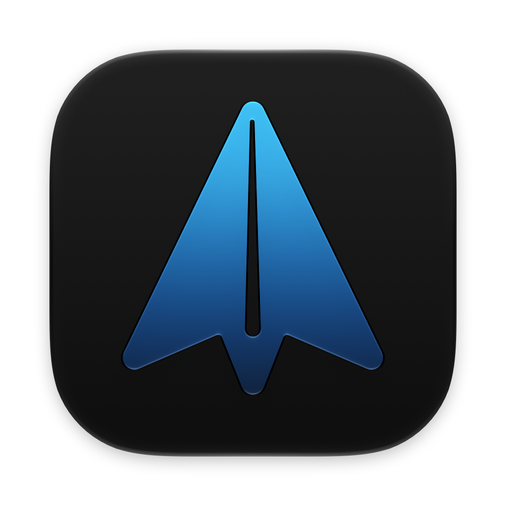

# Spark Desktop Icon (Neutral)

An alternative app icon for [Spark Desktop](https://sparkmailapp.com) on macOS. It is the same icon as the one Spark ships, without the decorative wave overlay, and it adapts to light and dark mode.

Unofficial. Not affiliated with, endorsed by or sponsored by Readdle.

<p>
  
  
</p>

## What is inside

| File | Purpose |
| --- | --- |
| `Assets.car` | Compiled adaptive icon (light and dark), named `dist` as Spark Desktop expects |
| `icon.icns` | Classic icon for places that do not use the adaptive one |
| `spark-icon-light.png`, `spark-icon-dark.png` | 1024 px previews, also usable as static custom icons |
| `Spark.icon/` | Icon Composer source of the adaptive icon |

Previews are 1024 x 1024 px with the standard macOS margin: the icon body is 824 x 824 px, from x=100 to 923 and y=100 to 923.

## Install (adaptive, light and dark)

Requires macOS 26 or later. Built for Spark Desktop 3.32.1.

1. Quit Spark Desktop.
2. In this folder, run:

```sh
APP="/Applications/Spark Desktop.app"

mkdir -p ~/Spark-icon-backup
cp "$APP/Contents/Resources/Assets.car" "$APP/Contents/Resources/icon.icns" ~/Spark-icon-backup/

cp Assets.car icon.icns "$APP/Contents/Resources/"
xattr -cr "$APP"
codesign --force --sign - --preserve-metadata=entitlements,flags,runtime "$APP"
```

3. Open Spark Desktop. If the old icon still shows, run `killall Dock`.

If macOS refuses the copy, allow your terminal under System Settings, Privacy & Security, App Management, then run the commands again.

### What to expect

- The `codesign` step replaces Readdle's signature with an ad hoc one. macOS may ask again for permissions granted to Spark (Contacts, Calendar, microphone, Keychain access).
- Every Spark update replaces the icon. Run the commands again after updating.
- Do this only if you accept those trade-offs.

### Revert

Quit Spark, then copy the two files back from `~/Spark-icon-backup/` and run the same `xattr` and `codesign` commands. Reinstalling Spark from the official site restores Readdle's original signature.

## Install without modifying the app (static)

Open Spark Desktop in Finder, choose File, Get Info, then drag `spark-icon-dark.png` or `spark-icon-light.png` onto the small icon at the top left of the window. This does not touch the app, but the icon does not switch between light and dark.

## Legal

The Spark name and the paper plane logo belong to Readdle Technologies Limited. This repository ships an alternative presentation of that logo for personal use and does not grant any right to it. If Readdle asks for removal, it will be removed.

The configuration and files created for this repository are released under the [MIT License](LICENSE). That license does not cover Readdle's name, logo or trademarks.
